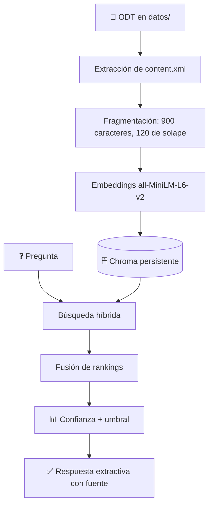

# 🔍 Mini Helpdesk HTML5


> **Buscador de documentación con respuesta extractiva, búsqueda híbrida y todo el procesamiento en local.**
> Sin APIs, sin claves y sin coste por consulta.

Le das un ODT y devuelve el fragmento que mejor responde a la pregunta, con su
documento de origen y un nivel de confianza. Si no hay información suficiente,
lo dice en lugar de inventar.

```
❓ pregunta  ➜  🔀 búsqueda híbrida  ➜  📄 fragmento + fuente + confianza
```

---

## ✨ Características

- 📥 **Ingesta tolerante**: algunos ODT llevan etiquetas HTML sin escapar
  (`<form>`, `<input>`, `<video>`); se sanean antes de parsear y se conservan
  como texto, que es justo lo que interesa en una guía de HTML5.
- 🧠 **Embeddings locales**: `all-MiniLM-L6-v2` mediante ONNX y CPU (incluido en
  Chroma). Nada sale del equipo.
- 🔀 **Búsqueda híbrida**: similitud vectorial + coincidencia exacta de términos
  con regex tolerante a acentos. Mejora siglas y nombres propios (`WCAG`,
  `SVG`, `canvas`).
- 📊 **Confianza explicable**: combina similitud y cobertura de términos; por
  debajo del umbral avisa en vez de responder.
- 🚫 **Cero dependencia de servicios**: no hay LLM, ni API, ni `.env`.

---

## 🧩 Requisitos

- 🐍 Python **3.12**
- 📂 Los ODT que quieras indexar en `datos/`

El repositorio incluye dos guías de HTML5 de ejemplo (16 fragmentos).

---

## 🚀 Puesta en marcha

```bash
python -m venv .venv
source .venv/bin/activate

pip install -r requirements.txt

python ingest.py        # indexa los ODT de datos/
./run.sh                # o: streamlit run app.py
```

> ⚠️ La app avisa si la colección está vacía. La ingesta es manual a propósito:
> nunca se reindexa al arrancar.

---

## 💬 Ejemplos de consulta

- ❓ ¿Cómo valido un formulario sin JavaScript?
- ❓ ¿Diferencia entre `canvas` y `SVG`?
- ❓ ¿Qué atributos tiene la etiqueta `video`?
- ❓ ¿Cuáles son las etiquetas semánticas de sección?
- ❓ ¿Qué significa `WCAG`?

---

## ⚙️ Cómo funciona



1. 📌 **Extracción**: se lee `content.xml` del ODT, se escapan las etiquetas HTML
   sueltas y se recorren encabezados, párrafos y tablas.
2. ✂️ **Fragmentación**: 900 caracteres con 120 de solape.
3. 🔢 **Vectorización**: `all-MiniLM-L6-v2` en local, distancia coseno, colección
   persistente en `chroma_db/`.
4. 🔀 **Recuperación**: 10 candidatos vectoriales y, por cada término relevante,
   un ranking filtrado por regex. Fusión:

   ```
   puntos = (1 - distancia) + 0.10 * min(términos coincidentes, 2)
   ```

5. 💬 **Respuesta**: el fragmento con más puntos, recortado a 900 caracteres.

```
confianza = 0.7 * similitud + 0.3 * cobertura de términos
```

---

## 📁 Estructura

```
mini_helpdesk/
├── config.py        # rutas, chunking, pesos y umbral
├── models.py        # Candidato y Respuesta (dataclasses)
├── ingest.py        # ODT → texto → fragmentos → Chroma
├── vectorstore.py   # Chroma + búsqueda híbrida
├── responder.py     # respuesta extractiva y confianza
├── app.py           # interfaz Streamlit
├── requirements.txt
├── run.sh
├── .streamlit/config.toml
└── datos/           # tus ODT
```

---

## 📥 Añadir documentos

Copia los `.odt` a `datos/` y vuelve a ejecutar:

```bash
python ingest.py            # añade o actualiza cada documento
python ingest.py --reset    # borra la colección y reindexa todo
```

---

## 🔧 Configuración

| ⚙️ Constante | 💾 Valor | 🎯 Para qué |
|---|---|---|
| `CHUNK_SIZE` | 900 | tamaño del fragmento |
| `CHUNK_OVERLAP` | 120 | solape entre fragmentos |
| `TOP_K` | 3 | resultados devueltos |
| `HYBRID_SEARCH` | `True` | activar/desactivar la parte léxica |
| `HYBRID_BONUS_TERMINO` | 0.10 | peso de cada término coincidente |
| `CONFIDENCE_THRESHOLD` | 0.45 | mínimo para responder |

---

## 📝 Notas

- 🌐 **Primera ejecución con red**: Chroma descarga el modelo ONNX
  `all-MiniLM-L6-v2` en `~/.cache/chroma/onnx_models/`. Después funciona
  offline. No se sube al repositorio.
- 🚫 **Sin generación**: la respuesta es texto literal de la documentación. Es
  una decisión de diseño: reproducible, rápida y sin alucinaciones.
- ⚖️ **Licencia de los documentos**: usa material propio o con licencia
  compatible. Si los ODT son de terceros, añade su atribución.
- 🧪 Probado con Python 3.12 y las versiones de `requirements.txt`.
